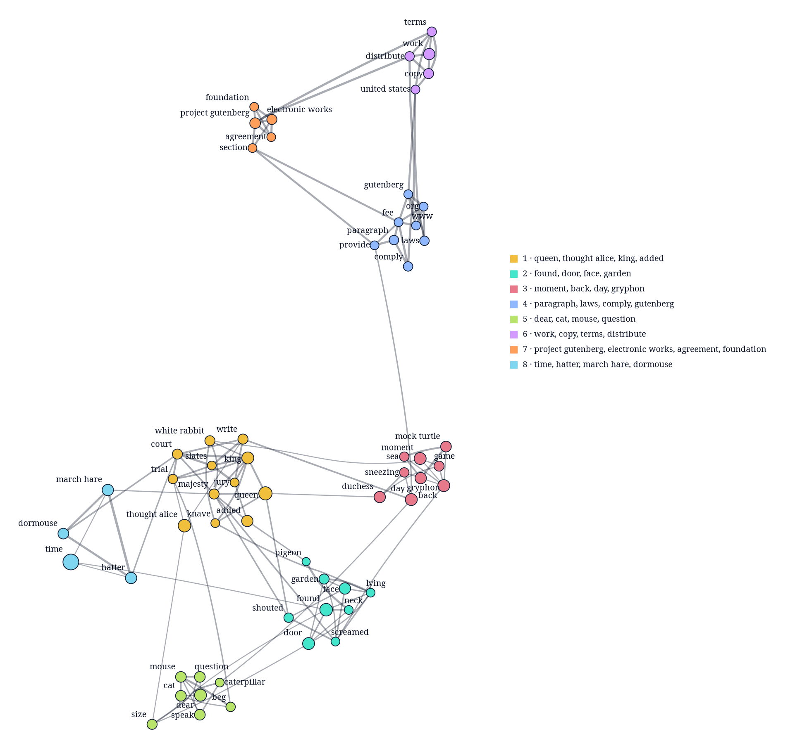

With concept-map and [furniture-detection](/projects/furniture-detection/) I set out to find the underlying structure of a text, using information theory where an AI model would otherwise do the work. concept-map finds the subjects a text keeps returning to, how they link and the communities they form, and every concept and link lists the passages behind it.

## Phrases

The text is lowercased and read word by word, where a word is a run of letters that may hold `-` or `'` between letters. A stopword from the 571-word SMART list, a word of fewer than three letters or any punctuation mark cuts the run. A run of one to three remaining words is a phrase, and a longer run is dropped whole. This is the candidate step of RAKE, and it keeps a multi-word name such as "march hare" together without a parser or a model. A phrase is keyed by its stemmed words, so "head" and "heads" count as one. It is a candidate when it stands as a phrase of its own in at least 3 passages, so that it recurs, and in at most 30% of them, so that it can still tell parts of the text apart. In *Alice's Adventures in Wonderland*, 166 passages of whole paragraphs, 581 of 2,716 distinct phrases are candidates, and "alice", alone in 105 passages, is too common.

## Topics from TF-IDF and factorisation

Concepts are chosen by how well they tell the parts of a text apart, so the passages are first sorted into $k$ topics, with $k$ the square root of the number of passages $n$, rounded and at least 2. Each passage becomes a row of a matrix $X$ with a column for every word that occurs in 2 or more passages and at most half of them. A cell holds

$$
x = (1 + \ln \mathrm{tf})\left(\ln\frac{1+n}{1+\mathrm{df}} + 1\right),
$$

where tf is how often the word occurs in the passage and df the number of passages holding it. The first factor grows with tf more slowly than tf itself, because a passage that repeats a word is about that word but not twice as much for saying it twice. The second is larger for words in fewer passages. Each row is scaled to unit length so that a long passage does not outweigh a short one.

Non-negative matrix factorisation approximates $X \approx WH$, with $W$ of size passages × $k$, $H$ of size $k$ × words and every entry at least 0, by lowering the squared error

$$
\lVert X - WH\rVert^2 = \sum_{i,j}\big(X_{ij} - (WH)_{ij}\big)^2
$$

with Lee and Seung's multiplicative updates

$$
H \leftarrow H \circ \frac{W^\top X}{W^\top W H + \epsilon}, \qquad W \leftarrow W \circ \frac{X H^\top}{W H H^\top + \epsilon}.
$$

Here $\circ$ and the fraction bar act entry by entry, and $\epsilon = 10^{-10}$ keeps a ratio defined. Each update is a gradient step with a step size chosen per entry, so no entry turns negative and, without $\epsilon$, the error never rises. Non-negative factors can only add topics together, never subtract one from another, so each row of $H$ is a group of words that occur together and row $i$ of $W$ says how much of each topic passage $i$ has. A passage belongs to the topic with the largest value in its row of $W$. In *Alice*, one topic of 13 passages weighs the stems hatter, dormous, march, hare and tea most, and it is the tea party.

## Concepts by mutual information

Let $T$ be a passage's topic and $G$ say whether the passage holds a given phrase. Their mutual information is

$$
I(T;G) = \sum_{t}\sum_{g \in \{0,1\}} p(t,g)\,\ln\frac{p(t,g)}{p(t)\,p(g)},
$$

where $p(t,g)$ is the share of passages that are in topic $t$ and have value $g$, and $p(t)$ and $p(g)$ are the shares of each alone. It is 0 when topic and phrase are independent and it never exceeds the entropy $\mathrm{H}(G) = -p\ln p - (1-p)\ln(1-p)$, with $p$ the share of passages that hold the phrase. Frequency alone favours phrases spread evenly through the text. Mutual information favours phrases whose passages fall in few topics, and its bound by $\mathrm{H}(G)$ keeps phrases in very few passages low: a phrase in 3 of 166 passages scores at most 0.090 nats. The 60 highest scores become the concepts. "march hare" stands in 17 passages, 12 of them in the tea-party topic, so it scores 0.200 of the 0.330 nats its entropy allows and ranks 8th of the 581 candidates.

## Links by NPMI

Let $d_a$ and $d_b$ be the numbers of passages that concepts $a$ and $b$ stand in, $s$ the number that both stand in and $n$ the number of passages. Placed independently, the two would share $d_a d_b / n$ passages on average. Pointwise mutual information is 0 at that chance level,

$$
\mathrm{pmi}(a,b) = \ln\frac{s\,n}{d_a d_b},
$$

but it cannot exceed $-\ln(s/n)$, so it favours rare pairs. Normalised PMI (NPMI) divides by that bound,

$$
\mathrm{npmi}(a,b) = \frac{\ln \dfrac{s\,n}{d_a d_b}}{-\ln \dfrac{s}{n}},
$$

which is 1 for concepts that only stand together, 0 at chance and $-1$ for concepts that never do. "hatter" stands in 18 passages and "march hare" in 17. They share 16 where chance predicts 1.84, so their PMI is $\ln 8.68 = 2.161$ against a bound of 2.339 and their NPMI is 0.924. Two concepts in 3 passages each that share 2 reach a higher PMI of 3.61 but an NPMI of only 0.82. Since NPMI has fixed meanings, one floor of 0.1 serves every pair in every text. Each concept keeps up to 3 partners that share at least 2 passages with it and score above the floor, the highest NPMI first, and a link exists when either concept keeps the other.

## Communities by modularity

The nodes are the concepts and the undirected edges are the links, weighted by NPMI. With $A_{ij}$ the weight between $i$ and $j$, $\deg_i$ the sum of the weights at $i$ and $m$ the sum of all edge weights, modularity is

$$
Q = \frac{1}{2m}\sum_{i,j}\Big(A_{ij} - \frac{\deg_i \deg_j}{2m}\Big)\,\delta(c_i, c_j),
$$

where $c_i$ is the community of node $i$ and $\delta$ is 1 when $i$ and $j$ share a community and 0 otherwise. The term $\deg_i \deg_j / 2m$ is the weight that would join $i$ and $j$ if the same total weight were spread at random with every node keeping its degree. $Q$ therefore rewards communities that hold more weight than their degrees predict, and a single community gives $Q = 0$. Because the comparison uses each node's degree, a concept with many links does not draw every concept it touches into its community.

The number of divisions grows faster than exponentially with the number of nodes, so the Louvain method does not try them all. Phase 1 visits the nodes in index order and moves each to the neighbouring community with the largest gain

$$
\Delta Q = \frac{A_{i,C}}{m} - \frac{\Sigma_C\,\deg_i}{2m^2},
$$

where $A_{i,C}$ is the weight of $i$'s links into community $C$ and $\Sigma_C$ the sum of the degrees in $C$ without $i$. It repeats until a sweep moves no node. Phase 2 collapses each community into one node, with its internal links as a self-loop, and the phases alternate until phase 1 moves nothing. The factorisation starts from a fixed seed and the nodes are visited in a fixed order, so the same passages give the same map on every machine.

## Example

On *Alice's Adventures in Wonderland* (166 passages) it finds 60 concepts, 123 links and 8 communities, among them the trial, the tea party and the Caterpillar. The map took 0.07 s to build. It has not been compared with maps made by people.

*The concept map of Alice's Adventures in Wonderland. Each colour is a community, a circle grows with the number of passages of its concept and a line thickens with its NPMI. The three communities at the top come from the Project Gutenberg licence that the book carries, because every passage counts as text.*
