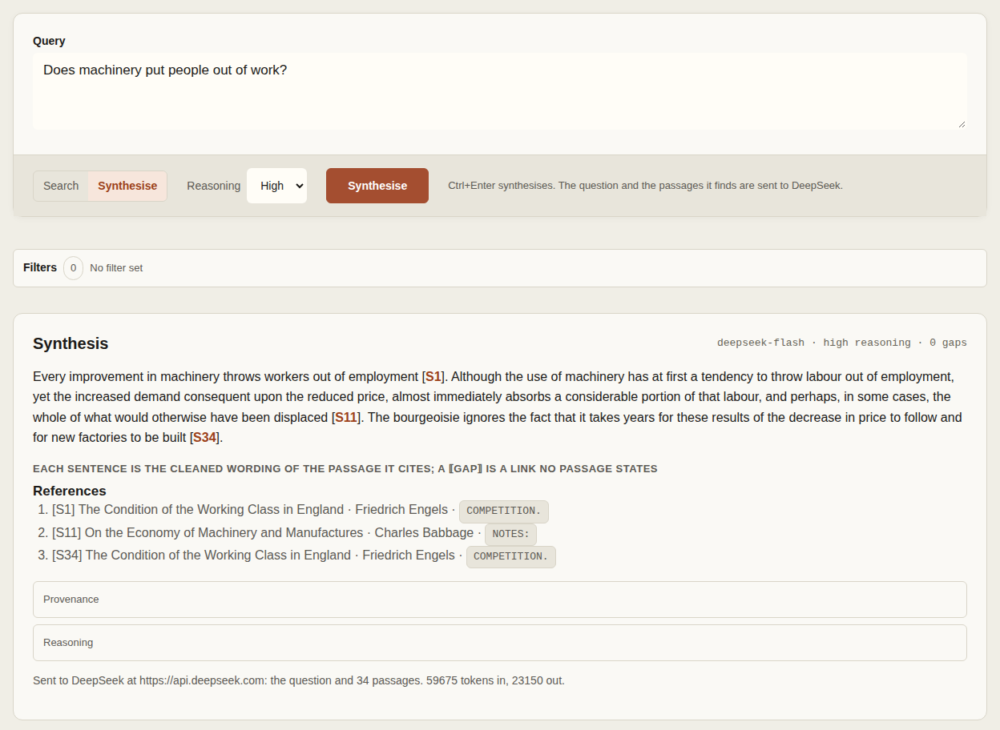
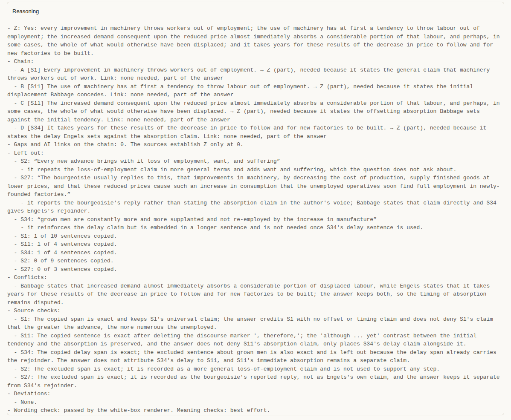

I built research-rag to find passages I remember only roughly. Existing solutions were black boxes, and I wanted clear provenance and references for all generated content.

## Ingestion and chunking

`ingest` converts each PDF with Docling, a layout model that labels each block of a page. Docling runs in a separate managed environment, eight pages at a time, with OCR switched off, so a page without a text layer yields no text. EPUBs are read by spine section and MOBIs by text part. Each page, section or text part is one extraction unit and keeps a locator into the original file, a navigation aid and not a quote offset.

Cleaning removes what Docling labels as running heads, page numbers and index entries. A reference or notes section is removed only when its heading is confirmed by bibliographic entries, and captions, formulas, tables, code and explanatory footnotes end the section and stay. Paragraphs with damaged encoding are repaired when the damage is reversible and withheld otherwise.

Chonkie cuts each unit into windows of $c=384$ GPT-2 tokens that overlap by $o=64$, so windows start $c-o=320$ tokens apart. A window never crosses a unit, so each chunk keeps one locator. The size is bounded by the embedding model's 512-token limit. GPT-2 and WordPiece tokens are counted differently, so a vector can still cover only a prefix of its chunk, which the build records: 26 of 42,002 chunks in one generation.

## Lexical and dense retrieval

Each query is ranked twice, and each ranking keeps $D=\min(M,\,200,\,\max(20,\,4k))$ chunks for $k$ requested results, where $M$ counts the chunks left by the filters. At $k=10$ this is 40.

BM25 matches the typed words, which serves exact names and phrases:

$$
\mathrm{score}(q,d)=\sum_{t\in q}\ln\!\Big(1+\frac{N-n_t+0.5}{n_t+0.5}\Big)\,\frac{f_{t,d}}{k_1\big(1-b+b\,|d|/\mathrm{avgdl}\big)+f_{t,d}}
$$

Here $N$ is the number of chunks in the index, $n_t$ the number containing the term $t$, $f_{t,d}$ the count of $t$ in chunk $d$, $|d|$ the length of $d$ in tokens after stopword removal and $\mathrm{avgdl}$ the mean length. The logarithm weights rare terms up, the fraction saturates repeated terms, and $b$ sets the penalty for long chunks. research-rag passes no parameters to bm25s, so $k_1=1.5$ and $b=0.75$ are the library's Lucene defaults.

The dense ranking embeds the query with BAAI/bge-small-en-v1.5 and scores each stored chunk vector by its cosine with the query vector:

$$
s(q,c)=\frac{\mathbf v_q\cdot\mathbf v_c}{\lVert\mathbf v_q\rVert\,\lVert\mathbf v_c\rVert}
$$

The scan is exact, a matrix product over the generation's float32 vectors, and it replaced UltraRAG's FAISS index because that index returns passage strings without identifiers or scores and cannot filter by metadata.

## The dense floor

Dense search returns its $D$ nearest chunks however far away they are, so a floor $\tau=0.72$ on the cosine stops an unanswerable query from receiving its least-bad passages. A margin $\delta=0.10$ keeps passages that matched almost as closely as a best hit that only just clears the floor. With $s_{\max}$ the highest cosine among the eligible candidates, the admission threshold is

$$
t=\begin{cases}\min(\tau,\;s_{\max}-\delta)&\text{if } s_{\max}\ge\tau,\\[2pt] \tau&\text{otherwise,}\end{cases}
$$

and a candidate is admitted when $s\ge t$. The margin acts only while $0.72\le s_{\max}<0.82$. A best hit of 0.721 admits everything down to 0.621, and a best hit of 0.719 admits nothing, so a search can return fewer results than requested, or none.

## Fusion

Fusion works on ranks, since a BM25 score and a cosine have no common scale. With $r(c)$ the rank of chunk $c$ in a ranking, counted from 1, and a term omitted when $c$ is absent from that ranking,

$$
\mathrm{RRF}(c)=\frac{w_{\mathrm{bm25}}}{k_0+r_{\mathrm{bm25}}(c)}+\frac{w_{\mathrm{dense}}}{k_0+r_{\mathrm{dense}}(c)},
$$

with $k_0=60$, $w_{\mathrm{bm25}}=1.25$ and $w_{\mathrm{dense}}=1.0$. A chunk ranked first by both rankings scores $2.25/61\approx0.0369$, and one ranked first by the dense ranking alone scores $1/61\approx0.0164$.

## Reranking

A cross-encoder reads the query and one passage together and scores the pair, where the embedding model encodes them separately. Only the leading $W=\min(n,\,50,\,\max(2k,\,10))$ of the $n$ fused candidates are scored, which is 20 at $k=10$, and the median search time in the evaluation rose from 0.24 s without reranking to 2.08 s with it. Candidates outside the window keep their fused order behind it, so a source whose best passage fell outside the window can still be reached. The model is Xenova/ms-marco-MiniLM-L-6-v2, and when it cannot load the fused order stands and the answer reports a fallback.

## Repetition and source diversity

A passage is dropped when its casefolded words equal those of a better-ranked kept passage, or when the cosine of their vectors is at least 0.99. This happens at search time, so both copies stay in the corpus and remain citable.

The final $k$ results are chosen greedily by the adjusted score

$$
a(c)=\rho(c)-\lambda\,m_{s(c)},
$$

where $\rho(c)$ is the reranker score rescaled to $[0,1]$ (the fused score without reranking, and 0 for the unscored tail), $\lambda=0.25$ is the penalty and $m_{s(c)}$ is the number of results already chosen from the source $s(c)$ of $c$. The step only reorders, and a stronger charge displaces more relevant passages of one source, a cost that a known-item evaluation cannot score.

## White-box synthesis

`synthesise` gives DeepSeek the retrieval above as a `search` tool, limited to eight calls by default, with `read_passage` for a passage's neighbours and `submit_derivation` for the result. Passages carry labels S1, S2 and so on, and the app supplies their text, so the model can name a passage and cannot alter it. The question, the system prompt and the retrieved passages are sent to DeepSeek's API, while indexing and search stay local.

*A synthesis over a demo project of nine public-domain books. Each sentence is the cleaned wording of the passage it cites.*

A derivation is a chain of steps leading to a conclusion $Z$, and the answer is submitted as pieces, each an exact span of one passage. Each step has a claim, the step it supports, a reason it is needed and a link status: `stated` when a quoted passage span states that relation between the same things in its own words, and `gap` when no passage does.

The renderer replays every piece as a COPY of its span, followed by at most DELETE of an exact sub-span, INFLECT for agreement or for replacing a pronoun by its antecedent, and NORMALISE for case, quotation marks, end stops, semicolons or a space inside a merged word. No operation adds a word. A derivation that needs other wording is refused, and the broken rule returns to the model for up to three attempts. Form rules such as word boundaries and capitals may bend if the sentence states a deviation, which is recorded, while exact copying and adding no word never bend. A `stated` link supplies the connective, such as "because", that joins pieces from different sentences, and a `gap` appears as a `⟦GAP⟧` marker, so no link written by the model enters the answer.

Provenance lists the operations behind each sentence. Reasoning lists each step with its reason and link, the passages left out, the conflicts between sources and the model's check of each source. The renderer verifies the wording, and the meaning checks are the model's, so a reader judges whether the passages support the answer.

*The Reasoning record of that synthesis.*

## Interfaces

One process per project serves the browser workspace, the command line and the MCP endpoint on one loopback port, so every interface reads the same generation.

## Evaluation

30 known-item queries over 18 passages of one private research corpus, measured on 11 October 2026 at ten results, with a passage-length floor that is off by default. Success@k is the share of queries whose one designated passage is among the first $k$ results, and MRR is the mean of $1/\text{rank}$ of that passage, with 0 for a miss.

| Mode | Success@1 | Success@10 | MRR |
|---|---|---|---|
| BM25 | 56.7% | 83.3% | 0.651 |
| Dense | 33.3% | 56.7% | 0.410 |
| Hybrid | 63.3% | 83.3% | 0.686 |
| Hybrid + rerank | 80.0% | 86.7% | 0.821 |

The judgments are known-item and single-annotator on one English-primary corpus, so the figures give no pooled recall, no exhaustive relevance and no general guarantee of retrieval quality.

Tests of the repetition step on constructed passages showed the limits of cosine similarity. Passages with reversed actors, a negated claim or a changed quantity scored between 0.9945 and 0.9967, above the 0.99 threshold, so the step drops one passage of each pair although their meanings differ.

## Next

Combining it with [concept-map](/projects/concept-map/), so that the concept graph captures relations through information theory while the RAG captures semantic similarity.

Built on [UltraRAG](https://github.com/OpenBMB/UltraRAG)'s MCP architecture, chunker and BM25 retriever. research-rag is independent and not affiliated with or endorsed by the UltraRAG project.
